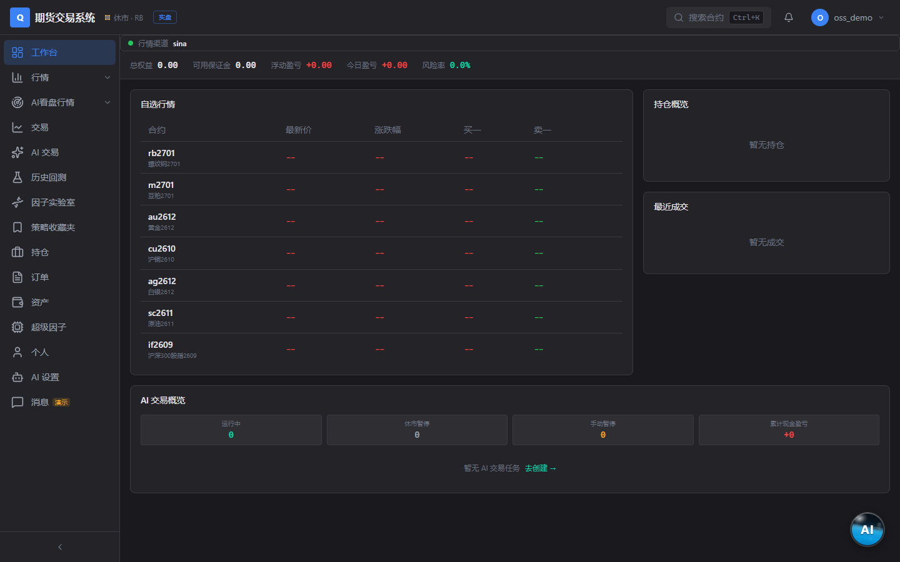
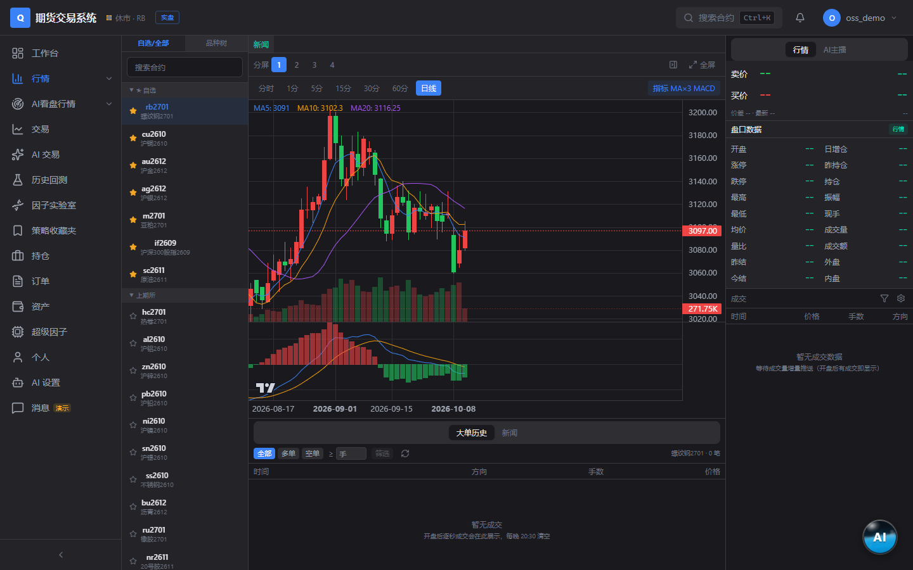
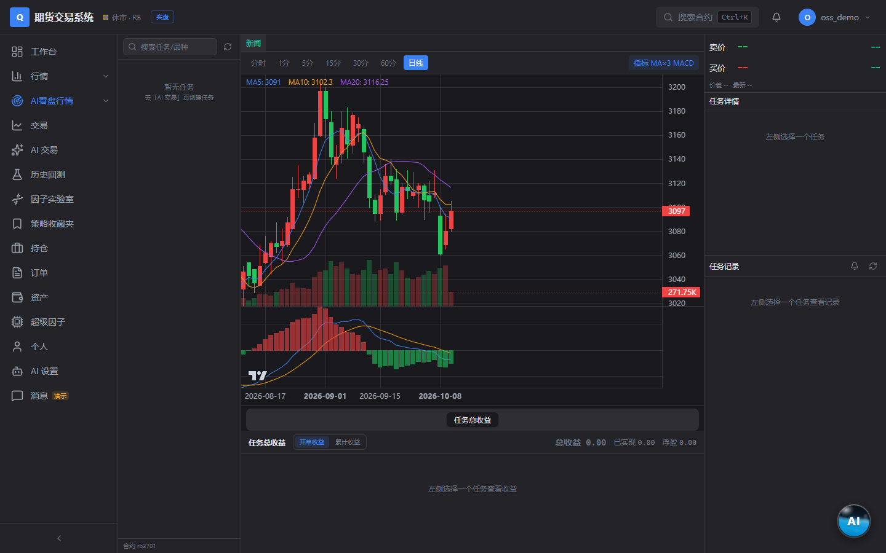
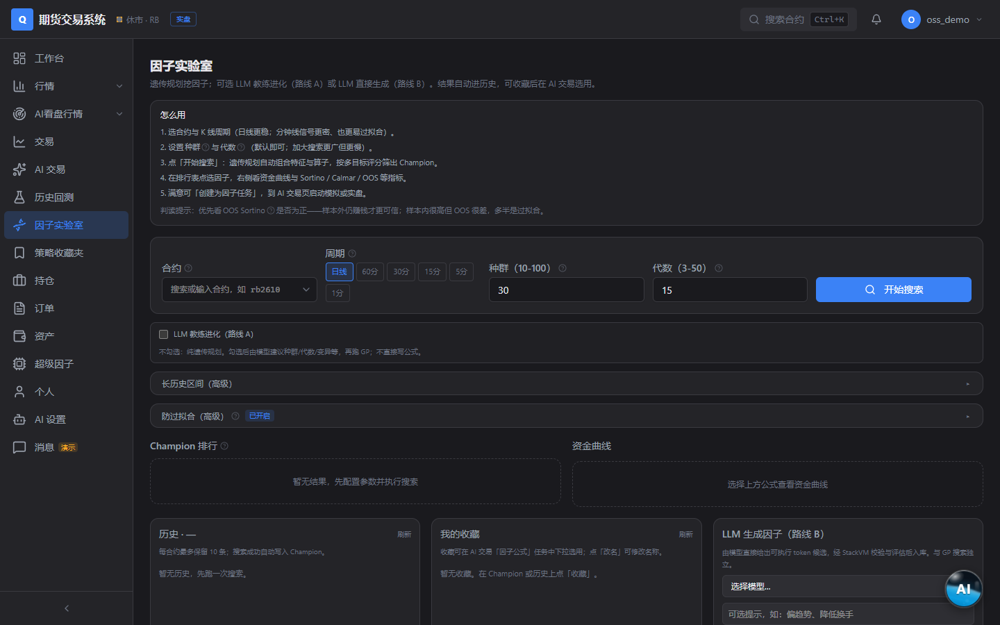

# 期货因子挖掘实验（Futures Factor Mining Experiment）

一个开箱即用的期货量化研究 / 模拟交易实验平台：因子实验室、策略回测、
模拟盘交易、AI 辅助看盘，全部数据自托管。

> 开源版说明：本仓库自带**新浪财经免费行情**（默认 5 秒刷新，无需任何
> 账号），其余行情源（CTP 前置等）不内置任何服务器地址——如有自己的
> 行情前置，请在管理后台自行填写 `tcp://` 地址接入。

## 界面展示


| 工作台 | 行情终端 |
| :---: | :---: |
|  |  |
| **交易终端** | **AI 看盘** |
|  |  |
| **因子实验室** | **历史回测** |
|  |  |

## 功能

- **行情**：新浪免费实时报价 + K 线历史（自选列表 / 品种树 / 五档盘口
  依赖所接行情源能力）
- **因子实验室**：内置 60+ 特征的表达式因子挖掘，token 编码可复现
- **回测**：多周期 K 线回测、AI 生成 K 线回测、决策模型回测
- **模拟交易**：纸面账户、挂单撮合、持仓 / 权益曲线、平仓标准
  （指标死叉 / 因子阈值 / 波段参考等）
- **量化任务**：策略信号实时计算、多周期共振、信号 K 线止损
- **AI 看盘**：LLM 驱动的主播式盘面播报与交易辅助（自配模型渠道）
- **管理后台**：行情渠道监控 / 主备切换、K 线源配置、用户与配额管理

## 技术栈

- 后端：Python 3.12 / FastAPI / SQLAlchemy(async) / PostgreSQL / Redis
- 前端：Next.js 15 / React 19 / TailwindCSS
- 部署：Docker Compose

## 快速开始

```bash
cp .env.example .env   # 按需修改数据库/Redis/JWT 密钥
docker compose up -d
```

详细自部署步骤（数据库建表、数据配置、环境变量）见
[docs/SELF-HOSTING.md](docs/SELF-HOSTING.md)。

## 行情源

| 源 | 说明 |
|----|------|
| `sina`（默认） | 新浪财经免费行情，5 秒刷新，零配置 |
| `ctp_sim` | 自定义 CTP 兼容行情前置——在管理后台「行情渠道监控」页填写你自己的 `tcp://host:port` |
| `openctp_724` | [openctp](https://github.com/openctp/openctp) 7×24 模拟环境（虚拟盘用） |

付费 / 私有行情源不在本仓库内置，接口地址一律由部署者自行配置。

## 免责声明

本项目仅供学习研究与模拟交易实验，不构成任何投资建议；接入实盘
行情或交易接口所产生的风险与合规责任由使用者自行承担。

## License

[MIT](LICENSE)

## 社区

本项目已链接认可 [LINUX DO](https://linux.do) 社区。

> LINUX DO —— 真实、友善、纯粹的交流社区
